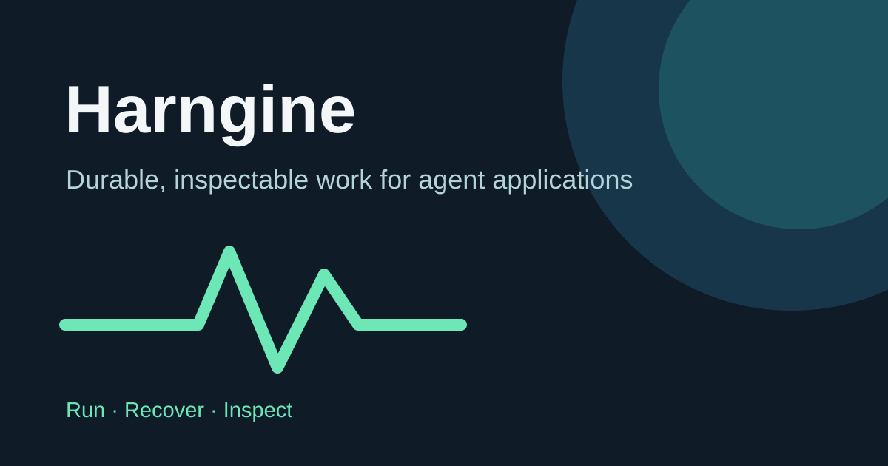
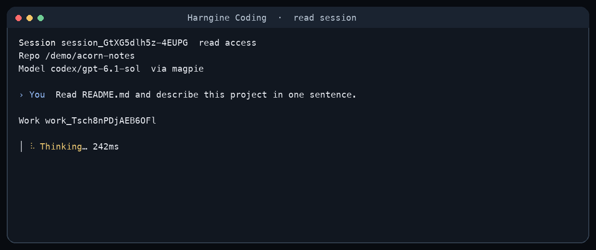
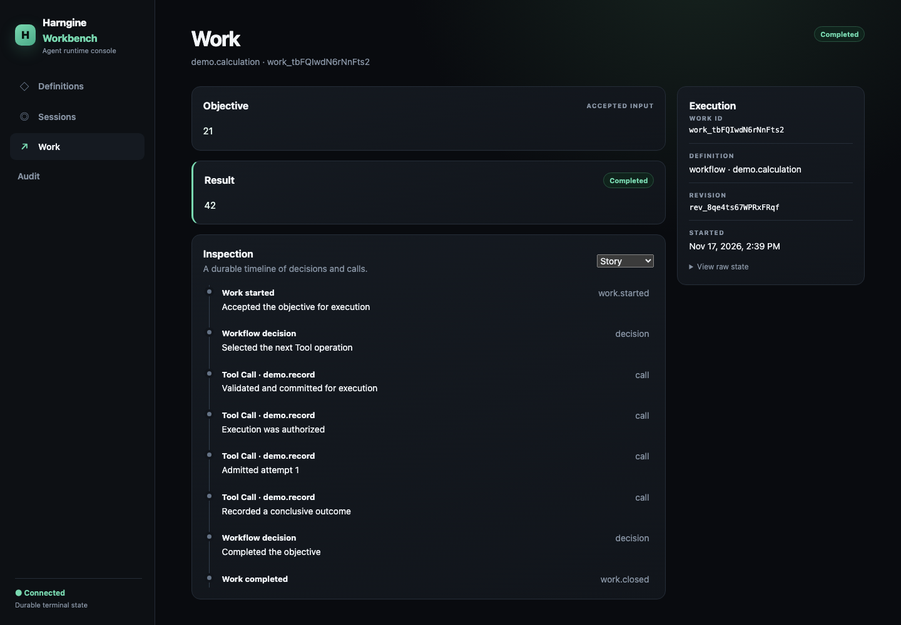

# Harngine

[简体中文](README.zh-CN.md)



Suppose a coding agent proposes a file edit. You approve it, but its process stops before it can
tell you whether the edit happened. Starting over could apply the change twice; assuming success
could leave the file untouched. The agent needs to know what it already did.

Harngine is a TypeScript runtime for building agents that can recover from interruptions like
this. It saves each run as inspectable **Work**: model decisions, Tool calls, approvals, and
results. When a Tool's effect is uncertain, the Work keeps that uncertainty visible until the app
checks the outside world or an operator resolves it.

Harngine is pre-release software. Its public API may change.

[Run the two-minute recovery demo](examples/quickstart/README.md) with the published package. It
kills a process during a durable wait and recovers the result from a new process without a model
account.

For a concrete application, [Harngine Coding](apps/coding/cli/README.md) reads a repository,
asks for approval before an exact edit, and runs a focused check. Its
[restart example](apps/coding/agent/examples/pending-approval-restart.mjs) stops while approval is
pending and reopens the same task with the file unchanged. A separate
[uncertain edit example](apps/coding/agent/examples/uncertain-edit-work.mjs) deliberately loses
the result *after* changing a file. The saved Work shows the unknown outcome; a read-only check
of the file resolves it without another edit. Both examples run from a source checkout; see their
[run instructions](apps/coding/agent/examples/README.md).

# Get Started

Harngine requires Node.js 24.21. Install the framework package from npm:

```bash
npm install harngine
```

Optional integrations are published under the `@harngine` scope. Install only those your
application uses.

## Framework example

The npm package `harngine` is the framework. Your application defines Agents or Workflows and
Tools, starts Work, and uses the runtime to recover and inspect it. For example, the
[recovery quickstart](examples/quickstart/README.md) defines a Workflow with a named Tool call and
a durable timer:

```ts
const calculation = workflow({
  id: 'demo.calculation',
  objective: number,
  result: number,
  tools: [record],
  async run(value, flow) {
    const answer = await flow.call('record', record, value);
    await flow.sleep('restart-window', 2_000);
    return answer;
  },
});
```

Here `number` and `record` are the example's declared schema and Tool. The [framework guide](docs/guide.md)
covers the complete API, persistence, approvals, and inspection.

The [framework introduction video](https://youtu.be/upyXdDo2EPY) explains where the runtime fits.
The applications below illustrate what can be built with it.

# Application examples

These applications run from a source checkout (`git clone https://github.com/neucine/harngine.git`,
then `cd harngine` and `bun install`). They are separate from the npm framework quickstart.

## Coding CLI

Harngine Coding is a terminal agent for repository work, with inspectable progress and approval
before file edits. See the [CLI guide](apps/coding/cli/README.md) for setup and commands. A
[macOS desktop guide](apps/coding/desktop/README.md) is also available.



## Workbench

Workbench lets you browse definitions, start Work, respond to approvals, and inspect the saved
history in a browser. The view below shows a completed workflow and its Tool call timeline. See
the [Workbench guide](packages/workbench/README.md) to run it with your app.



## Support Desk

The offline Support Desk example follows a duplicate charge through an approval-gated refund.
Watch the [69-second walkthrough](https://github.com/neucine/harngine/releases/download/v0.1.0/walkthrough.mp4)
or use the [Support Desk guide](examples/support/README.md) to run it.

## More application examples

- [Quest](examples/quest/README.md): a shared, persistent museum world with offline replay.
- [All examples](examples): support, museum, home, creative research, travel, and due diligence.

# Development

## Build and verify

```bash
bun run build
bun run check
```

Read the [framework guide](docs/guide.md), [package reference](packages/harngine/README.md), or
[architecture notes](docs/architecture.md). Harngine runs on an embedded Node.js runtime backed by
SQLite; Bun manages the workspace and builds.

# License

Harngine is licensed under the [Mozilla Public License 2.0](LICENSE). See
[CONTRIBUTING.md](CONTRIBUTING.md) for verification and [SECURITY.md](SECURITY.md) for private
vulnerability reporting.
