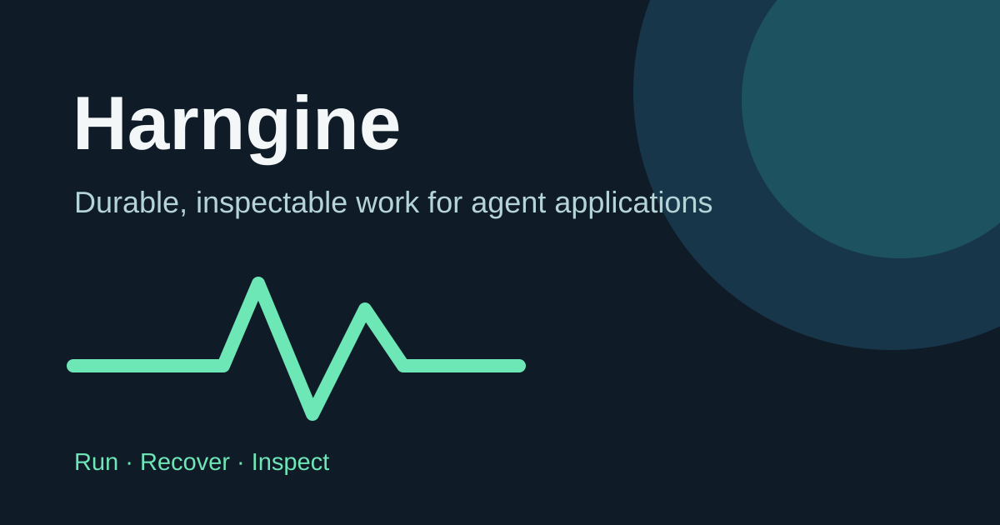

# Harngine

[简体中文](README.zh-CN.md)



Harngine is a TypeScript runtime for agents and workflows. It keeps model decisions, Tool calls,
approvals, and results durable enough to inspect or resume after a restart.

Harngine is pre-release software. Its public API may change.

# Get Started

Harngine requires Node.js 24.21. Install the framework package from npm:

```bash
npm install harngine
```

Optional integrations are published under the `@harngine` scope. Install only the ones your
application uses:

```bash
npm install \
  @harngine/openai-responses \
  @harngine/claude-messages \
  @harngine/mcp \
  @harngine/retrieval \
  @harngine/http
```

To run the Coding CLI and repository examples, clone the source and install its workspace:

```bash
git clone https://github.com/neucine/harngine.git
cd harngine
bun install --frozen-lockfile
```

# Examples

## Coding CLI

Harngine Coding is a terminal agent for repository work. It starts in read-only mode, streams live
progress, keeps Tool calls compact, and asks before applying each exact file change.

```bash
bun run coding:cli --repo .
```

Use `/write` to switch to an edit Session. `/sessions` and `--continue` resume saved work. For
automation, pass `--task`; add `--json` for one machine-readable result.

Local development defaults to Magpie and `codex/gpt-6.1-sol`. If Magpie is unavailable, the
interactive setup offers OpenAI, Claude, or Magpie. To use OpenAI directly:

```bash
OPENAI_API_KEY=... bun run coding:cli \
  --repo . \
  --provider openai \
  --model <model-id>
```

See the [Coding CLI guide](apps/coding/cli/README.md) for providers, thinking output, approvals,
one-shot runs, and Session commands.

The macOS app uses the same Agent and durable history:

```bash
bun run coding:desktop --repo "$PWD"
open -n apps/coding/desktop/build/NeivApp.app
```

Desktop builds currently need local [Neiv](https://github.com/neucine/neiv) and
[Weiv](https://github.com/neucine/weiv) checkouts. See the
[Coding Desktop guide](apps/coding/desktop/README.md).

## Support Desk

The offline Support Desk example follows a duplicate charge from customer request to an
approval-gated refund. It shows account evidence, a policy lookup, a durable Triage → Billing
handoff, the exact approval, and the completed audit trail.

```bash
bun run demo:support
```

Open the printed URL, select **Run review**, then approve the exact NZ$49 refund. No provider key,
payment service, or network connection is required.

Use `bun run demo:support:cli` for the same case in the terminal. See the
[Support Desk guide](examples/support/README.md) or watch the
[69-second walkthrough](https://github.com/neucine/promotion/tree/main/projects/harngine/support-refund).

## Additional examples

- [Quest](examples/quest/README.md): a shared, persistent museum world with offline replay.
- [Quickstart](examples/quickstart/README.md): kill a task mid-run, restart, and verify recovery.
- [All examples](examples): support, museum, home, creative research, travel, and due diligence.

# Development

## Build and verify

```bash
bun run build
bun run check
```

Read the [framework guide](docs/guide.md), [package reference](packages/harngine/README.md), or
[architecture notes](docs/architecture.md). Harngine runs on an embedded Node.js runtime backed by
SQLite; Bun manages the workspace and builds.

# License

Harngine is licensed under the [Mozilla Public License 2.0](LICENSE). See
[CONTRIBUTING.md](CONTRIBUTING.md) for verification and [SECURITY.md](SECURITY.md) for private
vulnerability reporting.
