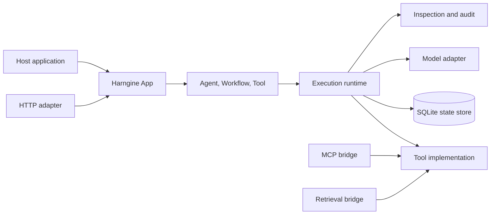

# Core architecture

This document describes the stable design boundaries of Harngine. It is for people extending the
framework, reviewing security and durability decisions, or building a host application around the
public API. The [framework guide](guide.md) explains how to use the API; this document explains why
the runtime is divided the way it is.

## Position

Harngine is the execution layer around model calls. A model can decide what to do next, but Harngine
owns the durable record, validation, authorization and lifecycle that surround that decision.

The host application owns users, authentication, authorization policy, domain state and external
side effects. Model adapters own provider wire protocols. Tool implementations own external
operations. Harngine owns the durable execution between those boundaries.

This separation keeps the core useful with different providers and transports:

## Public concepts

Five public concepts describe application intent:

- **Agent** is model-directed. It contains immutable instructions, a model adapter, typed input and
  output contracts, exposed Tools, delegates, limits and guardrails.
- **Workflow** is code-directed. It makes named Tool or child Work operations through a constrained
  asynchronous interface so accepted operations can replay after restart.
- **Work** is one durable execution. It owns its objective, status, decisions, Calls, interactions,
  limits, inspection history and terminal result.
- **Tool** is a typed external boundary. Its definition declares input, output, read or write
  effect, authorization, retry, reconciliation and reversal capabilities.
- **Session** is optional continuity across multiple Work executions. It records conversation and
  ownership lineage without becoming the unit of execution.

Definitions are compiled into stable identities with a `revision` of the form `rev_...`.
Registration makes a definition available; it does not automatically grant another Agent
permission to call it. Callable Agents and Workflows must be declared explicitly, and the runtime
checks the effective principal and execution limits.

## Application boundary

`createApp()` registers definitions with a principal and a directory-backed state store. Its scope
facade exposes two related surfaces:

- execution APIs such as `start()`, `run()`, `works` and `sessions`
- operational APIs such as `definitions`, `audit`, `diagnostics` and `storage`

`app.forPrincipal(principal)` returns a scoped facade. Every Work, Session and audit query is then
resolved under that principal. A transport must authenticate before using a principal scope; it
must not treat a request parameter as proof of identity.

The host owns the process lifecycle. Call `app.close()` during shutdown. By default this aborts
active provider and Tool invocations. The durable admission and outcome records determine what can
be retried or reconciled when the App reopens.

## Runtime layers

The runtime has several deliberately narrow layers:

| Layer | Responsibility |
| --- | --- |
| Definition registry | Resolves exact immutable Agent, Workflow and Tool revisions. |
| Scheduler | Starts runnable Work and coordinates process recovery. |
| Execution engine | Advances Work, evaluates definitions, validates proposals and records decisions. |
| Operation executor | Admits Calls, runs model/Tool invocations, records Attempts and reconciles unknown results. |
| Policy evaluator | Decides whether a definition or operation is authorized for the principal. |
| Wait manager | Owns durable questions, approvals, timers and external waits. |
| Session coordinator | Maintains message ordering, foreground Work and ownership handoff. |
| Inspection service | Projects durable evidence into story or diagnostic views. |
| Audit reader | Exposes payload-safe operational evidence without becoming execution authority. |

Adapters consume these layers through public contracts. They must not write execution tables or
infer successful state from a transport response.

## Execution lifecycle

A typical model-directed execution follows this path:

1. The host starts an Agent or Workflow with a JSON-compatible objective.
2. Harngine records a durable Work admission with principal, definition revision and limits.
3. The scheduler selects runnable Work and the execution engine asks the definition for a
   proposal.
4. Harngine validates the proposal against the objective, context, Tools, limits and current
   state.
5. A Tool or model operation is durably admitted before invocation.
6. The operation executes through its adapter or implementation.
7. Harngine validates the result, records the outcome, and either requests the next proposal or
   closes the Work.

Model choice and execution authority are separate. A model may propose a Tool Call, but Harngine
performs access checks, applies guardrails, records approval waits and invokes the Tool only after
the required boundaries succeed.

Workflow replay uses named operation slots and durable receipts. A completed named operation is
not repeated when the Workflow resumes. Promises created outside Harngine's flow API cannot provide
this identity or ordering guarantee.

## Durable state and recovery

The default state store is SQLite. Harngine also supports Node.js's built-in SQLite backend through
the same storage contract. Both backends use the same schema, migrations and execution semantics.

The state store provides:

- atomic state transitions
- exclusive runtime ownership for a state directory
- ownership epochs that fence stale processes
- idempotent receipts for accepted commands
- durable Work, Session, Attempt and inspection history

One application process should own a Harngine state directory at a time. Recovery restores accepted
Work from storage; active Work still needs the exact Agent and Tool revisions that were originally
registered. A process restart is not a reason to silently substitute a newer definition.

Admission and completion are different facts. Harngine records an operation before calling external
code and records a validated outcome afterward. If the process fails between those boundaries, the
operation is `unknown`. A read Tool may be safely retried under policy. A write is never assumed to
have failed and repeated automatically.

## External effects

Every write needs an explicit recovery posture. Tool definitions can declare idempotency,
reconciliation and reversibility capabilities, but the application remains responsible for making
the external operation truthful.

When an effect is uncertain, the application or operator can inspect the unresolved Call and
durably record one of these resolutions:

- `success`, with the actual validated Tool result
- `not-applied`, with a reason
- `failure`, with `partial` or `occurred` effect and a reason

Cancellation is also a durable control message. Aborting an in-flight transport is best effort and
is never evidence that a remote effect did not occur.

## Models and context

`ModelAdapter` is the provider boundary. An adapter translates a bounded `ModelRequest` into one
provider turn and normalizes the result into a `ModelResponse`. The core remains responsible for
Tool execution, approvals, effects, recovery and provenance.

Provider adapters can advertise capabilities, normalize usage, emit transient previews and resolve
selected artifact references. Transient model deltas are advisory. The final validated
`ModelResponse`, durable Work updates and inspection entries remain authoritative.

Context selection is bounded and recorded. Large application-owned bytes use
`ArtifactReference`; Harngine verifies identity, length and digest before an adapter resolves them
for provider-native input. The framework does not become the application's file store.

## Security boundaries

The core enforces these invariants:

- a Work cannot be read or controlled by another principal
- a child cannot widen its principal, child Work allowance or depth
- a model proposal does not grant execution authority
- a blocked Tool input creates no Attempt
- guardrail failures fail closed
- audit never becomes the source of execution truth
- telemetry runs after commit and cannot roll back Work
- retained audit data is filtered separately from execution records

Hosts must still implement authentication, rate limiting, network exposure policy, Tenant resource
limits and application-specific authorization. The HTTP adapter deliberately delegates those
decisions to the host.

## Inspection, audit and telemetry

Inspection is the detailed execution record. Story detail gives a compact user-facing sequence;
diagnostic detail includes payloads needed to debug a Work.

Audit is a separate payload-safe projection for operational review and export. It carries stable
identifiers, categories, actions, outcomes and safe reasons without objectives, prompts, messages,
Tool payloads or model content. Retention filters this projection and does not delete durable
execution authority.

Telemetry is post-commit and payload-free. Sink failures may lose telemetry, but cannot change Work
state. Applications that need proof of execution use Work inspection or audit, not telemetry.

## Extension model

Add integration at an existing boundary:

- add a model protocol as a `ModelAdapter`
- add an external operation as a typed `Tool`
- add discovery or translation as a separate integration package
- add transport in the host application or an optional adapter such as `@harngine/http`
- add metrics and benchmarks with `@harngine/evaluation`

Keep the core free of provider-specific request shapes, transport concerns and application domain
models. An integration should call public APIs or stable contracts and return validated values to
the runtime.

## Reading path

- [Framework guide](guide.md) for application usage
- [HTTP API guide](api.md) for the transport contract
- [`harngine` package](../packages/harngine/README.md) for the public execution API
- [`@harngine/http` package](../packages/http/README.md) for host integration
- [OpenAPI contract](../packages/http/openapi.yaml) for the generated-client source
